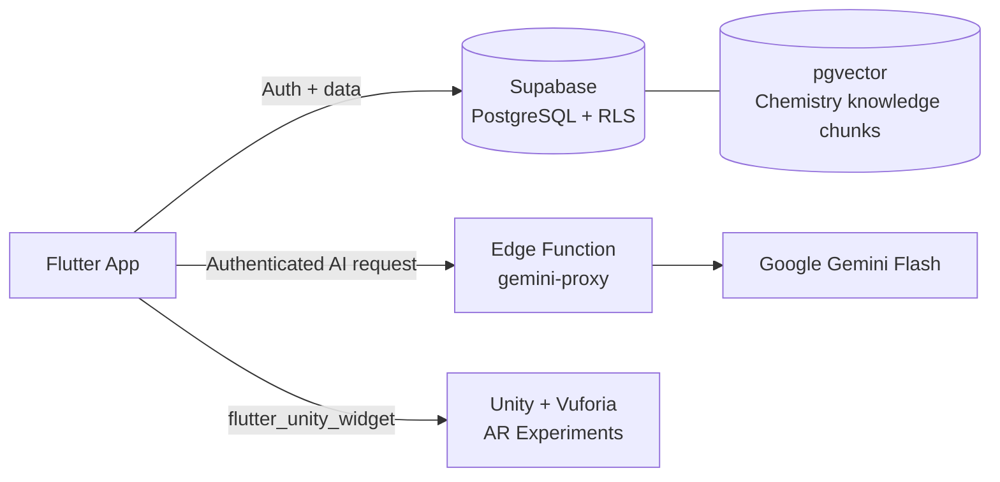
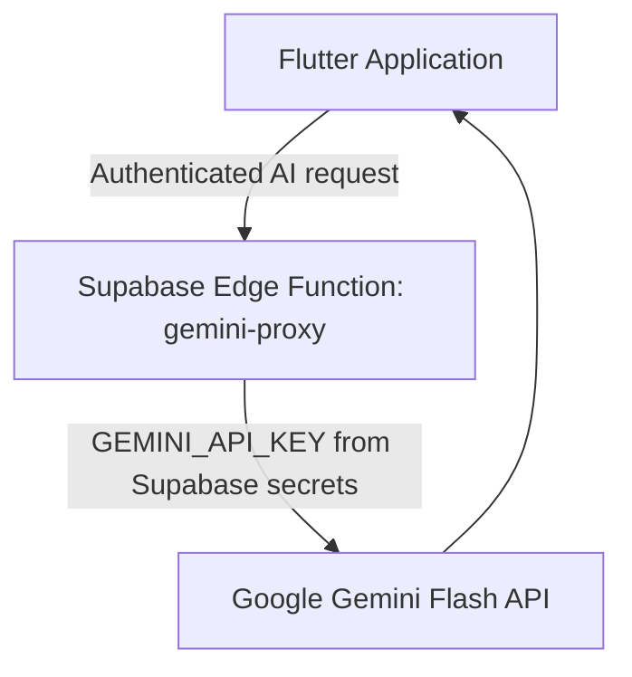
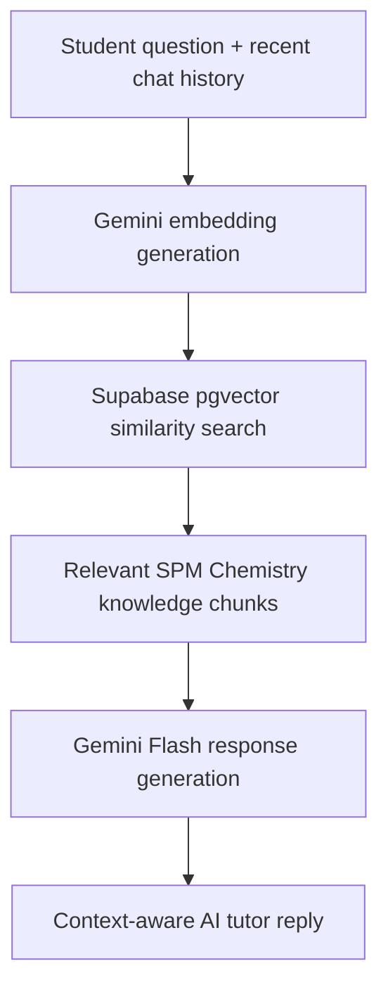
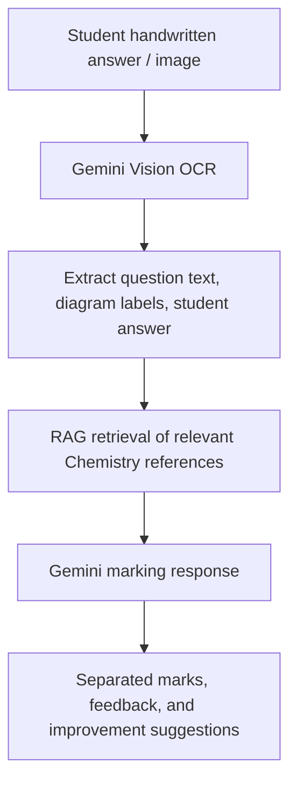

<div align="center">

# 🧪 ARChem

### An Immersive AR App for Chemistry Learning

An AI-powered Augmented Reality mobile app that helps Malaysian **SPM Form 4 Chemistry** students learn, practise, and visualise experiments, all in one place.


[Features](#-features) · [Screenshots](#-screenshots) · [Architecture](#-architecture) · [Getting Started](#-getting-started) · [Troubleshooting](#-troubleshooting)

</div>

---

## 📖 Table of Contents

- [About the Project](#-about-the-project)
- [Features](#-features)
- [Screenshots](#-screenshots)
- [Technology Stack](#-technology-stack)
- [Architecture](#-architecture)
  - [AI Pipeline](#ai-pipeline)
  - [RAG Tutor Pipeline](#rag-tutor-pipeline)
  - [AI Marking Pipeline](#ai-marking-pipeline)
- [Supported AR Experiments](#-supported-ar-experiments)
- [Project Structure](#-project-structure)
- [Getting Started](#-getting-started)
  - [Prerequisites](#prerequisites)
  - [Flutter Setup](#1-flutter-setup)
  - [Supabase Setup](#2-supabase-setup)
  - [Unity Setup](#3-unity-setup)
- [Security Notes](#-security-notes)
- [Troubleshooting](#-troubleshooting)
- [Known Limitations](#-known-limitations)
- [Roadmap](#-roadmap)
- [Generated Files Excluded from GitHub](#-generated-files-excluded-from-github)
- [Author](#-author)

---

## 🎯 About the Project

Many SPM Chemistry students struggle with abstract concepts and have limited access to lab equipment and personalised feedback. **ARChem** addresses this by combining:

- **Structured learning**: chapter-based content covering the Form 4 syllabus
- **Adaptive practice**: AI-generated quizzes and a study plan tailored to diagnostic results
- **On-demand help**: an AI tutor grounded in SPM Chemistry content through RAG
- **Instant feedback**: AI marking of subjective answers, including handwritten work
- **Visual understanding**: marker-based AR experiments that bring reactions to life

> This project was developed as a **Final Year Project (FYP)** at Universiti Tunku Abdul Rahman (UTAR).

---

## ✨ Features

### 📚 Learn
- Chapter-based learning content for all **8 SPM Form 4 Chemistry chapters**
- Marker-based **AR chemistry experiments** using Unity and Vuforia

### 📝 Practise
- AI-generated **diagnostic test** and chapter **MCQ quizzes**
- **Subjective quiz generation** with AI answer marking
- **Hardcoded question fallback** when AI services are unavailable

### 🤖 AI-Powered Support
- **AI Chemistry tutor** chatbot with follow-up question support
- **Retrieval-Augmented Generation (RAG)** for context-aware Chemistry answers
- **Handwritten answer and diagram-text extraction** using Gemini vision/OCR
- **Personalised weekly study plan** based on diagnostic performance
- **AI study-plan adjustment** through natural language requests

### 📈 Track Progress
- Quiz history, diagnostic results, student profile, and progress tracking
- User authentication with private learning data protected by **Supabase Row Level Security (RLS)**

---

## 📸 Screenshots

<!-- Replace the placeholders below with real screenshots / GIFs.
     Suggested folder: docs/screenshots/ -->

| Home Dashboard | AI Tutor | Weekly Study Plan |
| :---: | :---: | :---: |
|  |  |  |

| Quiz | AI Marking | AR Experiment |
| :---: | :---: | :---: |
|  |  |  |

🎥 **Demo video:** _add your YouTube / Drive link here_

---

## 🛠 Technology Stack

| Area | Technologies |
| --- | --- |
| Mobile Application | Flutter, Dart |
| State Management | Riverpod |
| Navigation | GoRouter |
| UI Animation | flutter_animate |
| Backend | Supabase |
| Database | PostgreSQL, JSONB, pgvector |
| Authentication | Supabase Auth |
| AI Model | Google Gemini Flash |
| AI Security | Supabase Edge Functions |
| RAG | Gemini Embeddings, Supabase Vector Search |
| AR Development | Unity 6, Vuforia Engine |
| AR Integration | flutter_unity_widget |
| Target Platform | Android ARM64 |

---

## 🏗 Architecture

### High-Level Overview



### AI Pipeline

All AI requests are routed through a Supabase Edge Function so the Gemini API key never reaches the client.



### RAG Tutor Pipeline



### AI Marking Pipeline



---

## 🔬 Supported AR Experiments

| Experiment | Concept Covered |
| --- | --- |
| Copper(II) Carbonate Heating | Thermal decomposition |
| Neutralisation | Acid–base reactions |
| Rate of Reaction | Factors affecting reaction rate |
| Salt Formation | Preparation of salts |

> AR experiments are **marker-based**. Print or display the experiment markers from `docs/markers/` _(add this folder or link)_ and point your camera at them to start.

---

## 📂 Project Structure

```text
lib/
  answer_marking/        AI marking feature
  auth/                  Authentication logic
  chatbot/               AI tutor chatbot
  chapters/              Chapter list and chapter data
  data/                  Hardcoded diagnostic and fallback questions
  diagnostic/            Diagnostic assessment
  experiments/           Unity AR experiment screens
  home/                  Home dashboard
  lecture_screen/        Chemistry lecture content
  profiles/              User profile feature
  quiz/                  MCQ quiz feature
  quiz_history/          Quiz history feature
  services/              Gemini and Supabase services
  subjective_quiz/       AI subjective quiz feature
  weekly_plan/           Personalised weekly study plan

supabase/
  functions/
    gemini-proxy/        Secure Gemini API Edge Function
  migrations/            PostgreSQL tables, policies, and RAG setup

unity/
  experimentscenes/      Unity AR source project
```

---

## 🚀 Getting Started

### Prerequisites

| Requirement | Version / Notes |
| --- | --- |
| Flutter SDK | Stable channel (run `flutter doctor` to verify) |
| Android Studio + Android SDK | For building and running on Android |
| VS Code or Android Studio | Editor of your choice |
| Unity | **6000.0 LTS** |
| Vuforia Engine | **11.4.4** |
| Supabase account | A project with SQL Editor and Edge Functions access |
| Google AI Studio account | Gemini API key |
| Test device | Android ARM64 device (AR requires a physical device with camera) |

### 1. Flutter Setup

Clone the repository:

```bash
git clone https://github.com/Wilsonowi/ARChem-An-Immersive-AR-App-For-Chemistry-Learning.git
cd ARChem-An-Immersive-AR-App-For-Chemistry-Learning
```

Install packages:

```bash
flutter pub get
```

Run on an Android device or emulator:

```bash
flutter run
```

Build a release APK:

```bash
flutter build apk --release
```

Output location:

```text
build/app/outputs/flutter-apk/app-release.apk
```

### 2. Supabase Setup

1. Create a Supabase project.
2. Update the Supabase URL and anonymous key in `lib/main.dart`.
3. Run the SQL files in `supabase/migrations/` using the Supabase SQL Editor.
4. Confirm that Row Level Security is enabled on all user-data tables.
5. Deploy the Gemini Edge Function (below).

Link your project:

```bash
supabase login
supabase link --project-ref YOUR_PROJECT_REF
```

Set the Gemini API key as a Supabase secret:

```bash
supabase secrets set GEMINI_API_KEY=YOUR_GEMINI_API_KEY
```

Deploy the Edge Function:

```bash
supabase functions deploy gemini-proxy
```

> **Note:** The RAG tutor and AI marking depend on the knowledge chunks stored in pgvector. If you are setting up a fresh project, make sure the embedding/seed step for the Chemistry content has been run, otherwise retrieval will return no context. _(Add the exact script or SQL file name here.)_

### 3. Unity Setup

The Unity source project is at:

```text
unity/experimentscenes
```

> **Important:** The generated Android export folder `android/unityLibrary` is excluded from this repository to keep it small. You must export it yourself.

1. Open `unity/experimentscenes` in **Unity 6000.0 LTS**.
2. Install or import **Vuforia Engine 11.4.4**.
3. Configure the AR scenes and add your **Vuforia licence key**.
4. Export the project as an **Android library**.
5. Place the generated library in:

   ```text
   android/unityLibrary
   ```

6. Rebuild the Flutter app:

   ```bash
   flutter clean
   flutter pub get
   flutter run
   ```

---

## 🔐 Security Notes

- Never store `GEMINI_API_KEY` in Flutter source code. Keep it only in Supabase Edge Function secrets.
- Never commit `.env` files, service-role keys, or personal credentials.
- The Supabase **anon key** is designed to be public, but only when **Row Level Security** is correctly enabled; the **service-role key** must never be shipped in the app.
- RLS restricts each user to their own learning records (quiz history, diagnostics, study plans, profile).
- All AI calls require an authenticated user and pass through `gemini-proxy`.

---

## 🩺 Troubleshooting

| Problem | Likely Cause | Fix |
| --- | --- | --- |
| AI features return errors or fall back to hardcoded questions | Edge Function not deployed, or `GEMINI_API_KEY` missing | Re-run `supabase secrets set` and `supabase functions deploy gemini-proxy`; check function logs in the Supabase dashboard |
| Tutor gives generic answers | pgvector knowledge chunks not loaded | Re-run the RAG migration/seed step |
| Build fails on `unityLibrary` | Unity export missing | Complete [Unity Setup](#3-unity-setup) and place the export in `android/unityLibrary` |
| AR camera opens but nothing appears | Missing/invalid Vuforia licence key, or wrong marker | Check the licence key in Unity and use the correct experiment marker |
| App crashes on emulator when opening AR | AR needs a real camera and ARM64 | Test on a physical Android ARM64 device |
| `flutter run` fails after changing Unity export | Stale build cache | `flutter clean && flutter pub get && flutter run` |

---

## ⚠️ Known Limitations

- Android (ARM64) only; iOS is not supported.
- AR experiments are marker-based and require the printed/displayed markers.
- AI responses depend on Gemini availability and API quota; fallback questions cover quizzes only.
- Handwriting OCR accuracy varies with image quality and handwriting style.
- Content currently covers **Form 4 only**.

---

## 🗺 Roadmap

- [ ] Extend content to SPM Form 5 Chemistry
- [ ] Add more AR experiments
- [ ] Markerless AR support
- [ ] iOS support
- [ ] Offline mode for lecture content
- [ ] Teacher dashboard for class progress

_(Edit this list to reflect your actual plans.)_

---

## 🗑 Generated Files Excluded from GitHub

```text
build/
.dart_tool/
android/.gradle/
android/unityLibrary/
unity/experimentscenes/Library/
unity/experimentscenes/Builds/
unity/experimentscenes/Logs/
unity/experimentscenes/UserSettings/
unity/experimentscenes/QCAR/
```

---

## 👤 Author

**Wilson Owi**
Final Year Project: _ARChem: An Immersive AR App for Chemistry Learning_
Universiti Tunku Abdul Rahman (UTAR)

[](https://github.com/Wilsonowi)

<!-- Add LinkedIn / email here if you want recruiters to find you -->

---

<div align="center">

⭐ If you find this project interesting, consider giving it a star!

</div>
